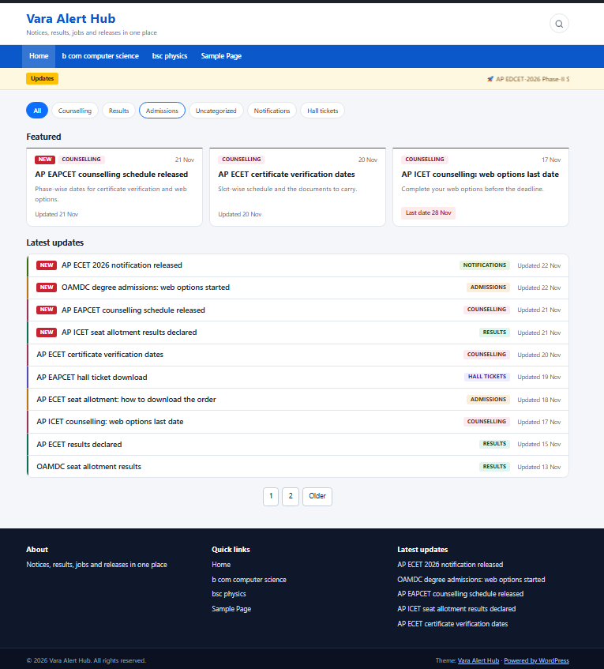

# Vara Alert Hub

**A clean, text-first WordPress theme for notices, announcements, results, releases and updates.**

Vara Alert Hub is designed for websites where information changes frequently and readers need to find important updates quickly.

## Features

- **Text-first layout:** Keeps important information easy to scan.
- **Updated dates:** Helps readers identify recently updated content.
- **NEW badges:** Highlights new posts and updates.
- **Live update board:** Provides a useful update board on 404 pages.
- **Optional featured images:** Supports visual content without making images mandatory.
- **Block patterns:** Includes patterns for notices, dates and guides.
- **Multiple page templates:** Offers different layouts for pages.
- **Customizer options:** Provides theme customization options.

## Installation

### From WordPress.org

Search for **Vara Alert Hub** in the WordPress theme directory once the theme is approved and published.

### Manual installation

1. Download the theme ZIP containing the `vara-alert-hub` theme folder.
2. Open your WordPress dashboard.
3. Navigate to **Appearance → Themes → Add New → Upload Theme**.
4. Select the ZIP file and click **Install Now**.
5. Activate the theme.

## Theme Information

| Detail | Information |
|---|---|
| Theme Name | Vara Alert Hub |
| Version | 1.0.0 |
| Author | Vara Prasad Jada |
| Theme Slug | `vara-alert-hub` |
| License | GNU GPL v2 or later |
| License URL | https://www.gnu.org/licenses/gpl-2.0.html |

## WordPress.org Review

Vara Alert Hub has been submitted to the official WordPress Theme Directory. The review is currently pending.

## Repository Structure

The `vara-alert-hub/` directory contains the WordPress theme source files, including templates, assets, patterns and theme documentation.

## License

Vara Alert Hub is distributed under the **GNU General Public License v2 or later (GPL-2.0-or-later)**.

See the [LICENSE](LICENSE) file for the full license text.

## Author

**Vara Prasad Jada**

